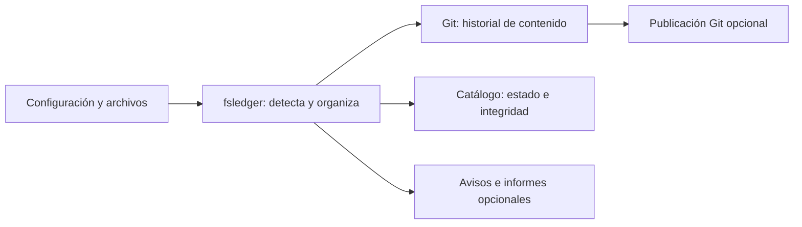

# fsledger

**Detecta cambios inesperados, investiga incidentes y recupera versiones registradas en Linux.**

[English](README.md) | [Español](README.es.md)

fsledger combina vigilancia de integridad de archivos (FIM), historial automático en
Git y alertas. Te ayuda a saber qué archivos cambiaron, cuándo se observaron esos cambios
y en qué difieren de la observación anterior. Cuando Linux proporciona la evidencia,
también registra el usuario y el proceso observados.

Conserva contenidos en Git para investigar y recuperar versiones, guarda hashes y
metadatos sin copiar contenidos, o combina ambas opciones. Esa evidencia ayuda a
investigar posibles infecciones, cambios no autorizados y errores de despliegue.

## Contenido

- [Por qué fsledger](#por-qué-fsledger)
- [Para qué sirve](#para-qué-sirve)
- [Qué aporta](#qué-aporta)
- [Detección de malware y respuesta a incidentes](#detección-de-malware-y-respuesta-a-incidentes)
- [Comparación con herramientas similares](#comparación-con-herramientas-similares)
- [Arquitectura](#arquitectura)
- [Requisitos](#requisitos)
- [Instalación](#instalación)
- [Primeros pasos](#primeros-pasos)
- [Configuración](#configuración)
- [Uso diario](#uso-diario)
- [Protección de datos](#protección-de-datos)
- [Licencia](#licencia)

## Por qué fsledger

La mayoría de los verificadores de integridad te dicen que un archivo cambió. fsledger
además te enseña cómo cambió y quién lo cambió cuando Linux puede saberlo, y te devuelve
la versión anterior.

- **Toda la respuesta en una sola herramienta.** Qué cambió y cuándo, el contenido de antes
  y de después en Git, y el usuario y el proceso observados.
- **Nada más que desplegar.** Dos binarios estáticos y un catálogo local: sin gestor de
  agentes, indexador, servidor de base de datos ni panel. Publica el historial en el
  servidor Git que ya usas.
- **Deja tu sistema como estaba.** No añade `.git` a tus directorios y usa Audit de forma
  pasiva: nunca instala reglas ni toma el control de auditd.
- **Pensado para servidores en producción.** Detección en tiempo real con fanotify e
  inotify, reconciliación para lo que los eventos no ven, recorridos programados para
  árboles grandes y sistemas de archivos remotos, y colas que sobreviven a los reinicios.
- **Avisos sin ruido.** Notificaciones agrupadas, filtros por usuario, comando o ruta,
  commits diferidos para archivos que cambian a menudo e informes programados.
- **Recuperación incluida.** Compara versiones y restaura una en un directorio aparte o
  en su sitio.

## Para qué sirve

- **Investigar posibles infecciones.** Identifica scripts inesperados, archivos de la
  aplicación alterados o cambios de configuración de arranque en las rutas que vigilas.
- **Entender un cambio de configuración.** Conserva versiones de `/etc` y de la
  configuración de tus aplicaciones para comparar el estado anterior y el actual.
- **Vigilar sitios web y servicios.** Detecta cambios de contenido, tipo de archivo,
  destino de enlaces, permisos y propietarios respecto a la observación anterior.
- **Revisar actividad sin seguir cada evento.** Recibe avisos agrupados o informes
  programados con las rutas afectadas y los cambios observados.
- **Separar necesidades por servicio.** Guarda en Git la configuración que quieres
  versionar y usa inventarios de metadatos para árboles cuyo contenido no necesitas
  archivar.
- **Compartir un historial fuera del servidor.** Publica los repositorios en tu
  servidor Git y, si lo habilitas expresamente, aplica cambios de una rama de confianza.

## Qué aporta

- **Historial automático en Git.** Cada repositorio conserva una copia independiente
  de sus fuentes, con commits agrupados y rutas reconocibles. No añade `.git` a los
  directorios de las aplicaciones.
- **Vigilancia de integridad.** Compara cada observación con la anterior: hash del
  contenido, tipo de archivo, destino de enlaces, permisos y propietarios. SHA256 es el
  algoritmo predeterminado.
- **Contexto para investigar.** Utiliza la información disponible de fanotify, `/proc`
  y Linux Audit para enriquecer los cambios con usuario y proceso. Si no puede identificar
  al actor, sigue registrando el cambio como desconocido.
- **Detección adaptada al entorno.** Combina fanotify, inotify y reconciliación, o utiliza
  escaneos por intervalo o cron cuando prefieres un recorrido programado.
- **Control del ruido.** Filtra avisos por usuario, comando o ruta, agrupa notificaciones
  y aplaza commits de cambios frecuentes sin perder la última versión observada pendiente.
- **Avisos e informes.** Envía alertas por correo o Slack y resúmenes programados por
  correo. Las colas pendientes sobreviven a los reinicios.
- **Recuperación de versiones registradas.** Consulta diferencias en Git, previsualiza
  una restauración y extrae una versión anterior a otro directorio antes de decidir
  qué devolver al servicio.
- **IA opcional.** Añade resúmenes a los commits o a los informes, con selección de rutas
  y reglas de ocultación antes de enviar información al proveedor.
- **Operación desde la CLI.** Valida la configuración, consulta el estado, diagnostica
  capacidades, lanza escaneos completos y restaura versiones registradas. Incluye integración
  con OpenRC y systemd.

## Detección de malware y respuesta a incidentes

Una escritura inesperada puede ser la primera señal visible de un sitio web o servicio
comprometido. fsledger facilita detectarla e investigarla: los avisos identifican las
rutas afectadas, las comprobaciones de integridad las comparan con la observación anterior
y el historial Git permite revisar el contenido registrado antes y después del cambio.
La comparación de hashes y atributos permite señalar cambios inesperados sin conocer
previamente la familia de malware o la vulnerabilidad implicada.

| Cambio observado | Qué aporta fsledger |
| --- | --- |
| Aparece un script en un directorio web vigilado | Registra el alta y puede enviar un aviso de cambio. |
| Se modifica código PHP o JavaScript | Registra diferencias de hash; los perfiles Git también conservan el contenido. |
| Cambian tareas cron, servicios o claves SSH | Registra cambios de contenido y permisos, y el usuario/proceso. |

Estas señales requieren investigación: un despliegue legítimo puede producir los mismos
tipos de cambios. Un commit Git o un aviso entregado no significan que un cambio sea
legítimo, y el historial Git puede contener tanto versiones maliciosas como legítimas.

### Ejemplo: PHP2Shell

El [artículo de Aikido sobre PHP2Shell][php2shell] trata las CVE-2026-109618 y CVE-2026-109619.
El [aviso de PHP del 21 de octubre de 2026][php-security] confirma vulnerabilidades críticas
de ejecución remota de código y enumera las correcciones. Aplica las actualizaciones de
seguridad correspondientes de PHP o de tu distribución; instalar fsledger no cierra esas
vulnerabilidades.

Como escenario ilustrativo, imagina que un atacante consigue ejecutar código y después
escribe una web shell en un árbol `/srv/www` vigilado o modifica un archivo PHP existente.
Si fsledger observa esa escritura, puede registrar el cambio, avisar a tu equipo y
conservar el contenido en un perfil Git. Las diferencias registradas muestran qué cambió
en el archivo, aunque su nombre parezca normal.
El ejemplo ilustra la vigilancia de archivos; no describe un detector específico de esas
CVE ni afirma cómo se han explotado.

### Prepara una vigilancia útil antes del incidente

1. **Parte de un estado confiable.** Revisa un despliegue limpio antes de empezar a
   vigilarlo: el [primer inventario](#integridad) es el estado con el que se comparan los
   cambios posteriores. Empezar a vigilar un servidor ya infectado registra como normal el
   estado infectado. Revisa los cambios que produce cada despliegue.
2. **Elige rutas según la evidencia que necesitas.** Incluye el código de la aplicación
   y la configuración relevante, las tareas programadas y las claves de acceso.
   Considera también los directorios de subidas: excluir un árbol escribible completo
   puede ocultar scripts inesperados. Usa un perfil DB cuando guardar el contenido
   exponga secretos o consuma demasiado espacio, y revisa las
   [exclusiones y rutas reservadas](#protección-de-datos).
3. **Activa avisos oportunos y comprueba su entrega.** Usa `watch.backend: auto`, mantén
   activas las reconciliaciones y los escaneos completos de hashes, y conserva
   `integrity.hash.on_event: true`. Selecciona un destino configurado en `notifications.use`
   e incluye `change`, `error` y `recovery` en `notifications.events`.
   Consulta `fsledger doctor` y `fsledger status`, y comprueba que un cambio controlado
   genera un aviso. El ejemplo nocturno `web-polling` comunica los cambios de archivos
   en su informe programado; no está configurado para avisar de ellos de forma inmediata.
4. **Conserva evidencia fuera del servidor afectado.** Publica el historial Git en un
   remoto privado y protege las copias de seguridad y las notificaciones por separado.
   El estado local y un remoto Git escribible no son inalterables: un atacante con
   suficientes privilegios puede modificar evidencias o detener la vigilancia.
   La publicación copia el historial Git, no el catálogo de integridad completo.
5. **Investiga antes de restaurar.** Preserva la evidencia y aísla el servicio afectado.
   Revisa los avisos y los informes de las rutas afectadas; con el daemon detenido, `verify`
   vuelve a escanear todas las fuentes y registra en el catálogo los cambios aún no
   observados. En perfiles Git, revisa el historial
   y [extrae una versión verificada a otro directorio](#uso-diario). Corrige la vía de entrada
   antes de devolver el servicio a producción. Restaurar archivos registrados no elimina
   todos los archivos maliciosos añadidos ni demuestra que el servidor esté limpio;
   los perfiles DB no conservan contenidos que restaurar.

fsledger aporta evidencia sobre cambios observados en el sistema de archivos. No bloquea
peticiones de explotación ni la ejecución de procesos, no clasifica archivos como malware
ni elimina infecciones. Un ataque que solo utilice memoria, lea secretos o cambie datos
fuera de las rutas vigiladas puede no dejar evidencia en fsledger. La detección también
depende de las exclusiones, la cobertura de los detectores, los horarios de escaneo y la
entrega de avisos. Combínalo con actualizaciones, mínimos privilegios, protección de la
aplicación, logs y copias de seguridad independientes.

## Comparación con herramientas similares

Cada herramienta cubre una parte de la misma necesidad. Este resumen sigue la
documentación pública de cada proyecto en octubre de 2026; compruébala para la versión
que uses.

| Herramienta | Tiempo real | Quién lo cambió | Contenido anterior | Avisos | Servidor | Plataformas |
| --- | --- | --- | --- | --- | --- | --- |
| **fsledger** | Sí | Si Linux lo indica | Git, con restauración | Correo, Slack, informes | No | Linux |
| [FIM][achiefs-fim] | Sí | Con auditd | No (historial de eventos) | Vía indexador | No | Linux, macOS, Windows |
| [Wazuh FIM][wazuh-fim] | Sí | Who-data (Audit) | Diffs de texto | Servidor Wazuh | Sí | Linux, Windows, macOS y otros |
| [AIDE][aide] | No | No | No | Informes | No | Tipo Unix |
| [etckeeper][etckeeper] | No | No | `/etc` en Git | No | No | Tipo Unix |
| [gitwatch][gitwatch] | Sí | No | Git | No | No | Linux, macOS |

fsledger obtiene el usuario y el proceso de fanotify, `/proc` y las reglas de Audit que ya
tengas, sin instalar ninguna; un escritor que no puede identificar queda como desconocido
y el cambio se conserva igualmente. Wazuh añade sus propias reglas de Audit para who-data,
y FIM necesita auditd.

**FIM** y **Wazuh FIM** encajan en entornos mixtos con Linux, Windows y macOS, o en equipos
que ya reúnen los eventos de seguridad en un indexador o un SIEM. fsledger puede funcionar
junto a ellos en los servidores Linux para conservar contenidos y puntos de recuperación.

**AIDE** encaja si quieres verificaciones periódicas frente a una referencia que inicializas
y actualizas de forma explícita, mientras que fsledger compara cada observación con la
anterior y registra cada cambio que observa.

**etckeeper** encaja si te basta el historial de `/etc` y su relación con las actualizaciones
de paquetes, y **gitwatch** si quieres commits automáticos de un directorio de trabajo al
guardar archivos.

**fsledger** encaja en servidores Linux donde quieres, con una sola herramienta autónoma,
saber qué cambió, revisar y recuperar el contenido anterior, ver quién lo hizo cuando es
posible y recibir avisos agrupados, sin mantener un servidor ni un indexador. Los perfiles
Git y DB pueden vigilar las mismas fuentes: contenido donde quieres historial y solo
metadatos donde el contenido es secreto o demasiado grande para archivarlo.

## Arquitectura

fsledger organiza el seguimiento alrededor de tus servicios: eliges qué vigilar,
qué conservar y cómo recibir los resultados. Puedes empezar con un solo directorio
y añadir perfiles con políticas distintas a medida que lo necesites.



**Un historial separado de las aplicaciones.** Los repositorios Git guardan sus propias
copias; los perfiles DB conservan metadatos, sin duplicar el contenido de los archivos.
Ambos mantienen un catálogo de integridad. La vigilancia no modifica las fuentes salvo
que habilites expresamente la sincronización bidireccional. La CLI también permite
restaurar archivos cuando lo solicitas.

**Continuidad para el trabajo diario.** La vigilancia detecta eventos y las reconciliaciones
contrastan el estado del disco. Un archivo inestable conserva su última copia válida
mientras los demás pueden avanzar. Las notificaciones pendientes se guardan de forma
duradera y un fallo de publicación remota permite seguir creando historial local.

**Control por repositorio.** Cada perfil organiza sus copias y operaciones Git en orden,
mientras distintos repositorios pueden trabajar concurrentemente. Un presupuesto común
limita el trabajo de escaneo. La preparación de informes y el envío de avisos se ejecutan
fuera del trabajo de copia y commits.

El servicio `fsledgerd` mantiene la vigilancia y la CLI `fsledger` permite administrarlo.
Git conserva el historial y un catálogo local Pebble guarda el inventario y el trabajo
pendiente. No necesitas un servidor de base de datos adicional.

## Requisitos

- **Linux** para ejecutar el daemon y la CLI.
- **Git 2.36 o posterior** para los repositorios de contenido; las versiones anteriores no
  sincronizan los commits con el disco.
- **Go 1.27.3 o posterior y Make** para compilar desde el código fuente. Los binarios
  de producción se construyen sin CGO y no necesitan Go instalado para ejecutarse.
- Permisos de lectura sobre las fuentes y de escritura sobre las rutas de estado.
  fanotify puede necesitar privilegios adicionales; el modo automático dispone de
  alternativas con inotify y polling.
- Acceso a un remoto Git, un transporte de notificaciones o un proveedor de IA solo
  si activas esas funciones. Los calendarios con zona horaria necesitan sus datos IANA.

## Instalación

### Binarios precompilados para Linux x86_64

Las [releases de GitHub](https://github.com/inode64/fsledger/releases) publicadas adjuntan
`fsledger-linux-x86_64`, `fsledgerd-linux-x86_64`, `LICENSE` y `SHA256SUMS` después de
superar las comprobaciones del proyecto. Ambos binarios incluyen el tag de la release en
`--version`, se compilan sin CGO y usan `GOAMD64=v1` para admitir CPUs x86-64 antiguas.

Descarga los cuatro assets de la misma release y verifícalos antes de usarlos:

```sh
sha256sum --check SHA256SUMS
chmod +x fsledger-linux-x86_64 fsledgerd-linux-x86_64
./fsledger-linux-x86_64 --version
./fsledgerd-linux-x86_64 --version
```

Los assets contienen los ejecutables; los ejemplos de configuración, manuales y archivos
del servicio están en el archivo de código fuente del mismo tag. Revisa la configuración
como se indica en [Primeros pasos](#primeros-pasos) antes de ejecutar el daemon.

### Compilación desde el código fuente

```sh
git clone https://github.com/inode64/fsledger.git
cd fsledger
make build
sudo make install
```

La instalación añade los dos binarios, los manuales y los ejemplos de configuración.
No sobrescribe los archivos de configuración que ya existen ni arranca el servicio.
Los destinos predeterminados son `/usr/bin/fsledger`, `/usr/sbin/fsledgerd` y
`/etc/fsledger`. Puedes ajustarlos mediante `PREFIX`, `SYSCONFDIR` y las demás
variables de instalación del [Makefile](Makefile); `DESTDIR` permite preparar un paquete.

Make usa `GOAMD64=v1` por defecto para conservar compatibilidad con CPUs x86-64 antiguas.
Puedes identificar una compilación con `make build VERSION=v1.2.3` y consultar el
resultado mediante `fsledger --version`.

**Antes de arrancar**, revisa los perfiles instalados. `system` selecciona configuración
para Git; `web-polling` selecciona `/srv/www` para un inventario nocturno y habilita
correo con datos de ejemplo. Adapta ese notifier o desactiva sus avisos e informes.
Para empezar solo con `system`, fija `paths.repositories: [services/system.yaml]`
en el YAML principal. Consulta [Primeros pasos](#primeros-pasos) para validar la selección.

### OpenRC

```sh
sudo make install-openrc
sudoedit /etc/fsledger/fsledger.yaml
sudo rc-service fsledger checkconfig
sudo rc-update add fsledger default
sudo rc-service fsledger start
sudo rc-service fsledger status
```

Puedes elegir otro YAML en `/etc/conf.d/fsledger` mediante `fsledger_config`.
Para aplicar cambios de configuración, ejecuta `sudo rc-service fsledger restart`.

### systemd

```sh
sudo make install-systemd
sudoedit /etc/fsledger/fsledger.yaml
sudo fsledger check
sudo systemctl daemon-reload
sudo systemctl enable --now fsledger
sudo journalctl -u fsledger -f
```

Para aplicar cambios de configuración, ejecuta `sudo systemctl restart fsledger`.
La [unidad incluida](packaging/fsledger.service) arranca tras los sistemas de archivos locales y
remotos y restringe las rutas escribibles; si personalizas el almacenamiento o habilitas escrituras
en las fuentes, adapta su configuración.

### Actualización

Descarga o revisa la nueva versión del código, vuelve a compilar e instala los binarios
con `sudo make install-bin install-man`. Este destino actualiza binarios y manuales
sin añadir perfiles de ejemplo. Valida el YAML con la CLI nueva y reinicia el servicio
para que use el nuevo ejecutable. Conserva la versión anterior para poder revertir
una actualización si lo necesitas.

## Primeros pasos

Revisa la configuración principal y los perfiles antes del primer arranque:

```sh
sudoedit /etc/fsledger/fsledger.yaml
sudoedit /etc/fsledger/services/system.yaml
sudo fsledger check -c /etc/fsledger/fsledger.yaml
sudo fsledger doctor -c /etc/fsledger/fsledger.yaml
```

`check` valida las opciones y las rutas seleccionadas. `doctor` comprueba las capacidades
del entorno y muestra los detectores disponibles. Para una primera ejecución en primer
plano, con el servicio detenido:

```sh
sudo fsledger run -c /etc/fsledger/fsledger.yaml
```

Detén esa ejecución antes de iniciar el servicio OpenRC o systemd. El daemon prepara
automáticamente los repositorios y, por defecto, realiza un escaneo inicial; con el
catálogo vacío registra cada entrada como creada (consulta [Integridad](#integridad)).
Un perfil de polling con `on_start: false` espera a su horario.

Con el servicio activo puedes consultar su estado y el historial de `system`:

```sh
sudo fsledger status
sudo git -C /var/lib/fsledger/repos/system log --stat
sudo git -C /var/lib/fsledger/repos/system log -p -- etc/ssh/sshd_config
```

Las rutas del mirror conservan la estructura desde `/`: por ejemplo,
`/etc/ssh/sshd_config` se guarda como `etc/ssh/sshd_config` dentro del repositorio.
Puedes consultar y extraer versiones con las herramientas habituales de Git.

## Configuración

La configuración principal reúne las políticas comunes y señala dónde cargar los perfiles.
Cada repositorio puede ajustar sus propias opciones. Los campos omitidos heredan el valor
global y los campos desconocidos se rechazan para detectar errores de configuración.

### Rutas y perfiles reutilizables

Un archivo principal mínimo:

```yaml
paths:
  repositories: [services]
runtime: /run/fsledger
storage:
  path: /var/lib/fsledger/repos
```

Un perfil `services/system.yaml` para versionar configuración:

```yaml
type: git
paths:
  - /etc
  - /usr/src/linux/.config
  - /var/spool/fcron/*.orig
notifications:
  use: []
```

El nombre del archivo da nombre al repositorio. Las rutas de los directorios de perfiles
son relativas al YAML principal; las fuentes son rutas absolutas o patrones sobre ellas.
Las entradas ausentes se omiten sin error y se incorporan cuando aparecen en una nueva
reconciliación. Una entrada o un patrón que no se puede leer (permiso denegado, error de E/S,
handle obsoleto, bucle de symlinks) también se omite, pero nunca se toma por borrado: el demonio
conserva lo que registró ahí, y `verify` se niega a ejecutarse hasta que vuelva a poder
leerse. Del mismo modo, se registran los puntos de montaje que contienen una fuente o están
dentro de una, también entre reinicios: mientras no hay nada montado en uno de ellos, el
repositorio espera en lugar de registrar su árbol como borrado, envía un aviso de error y
`status` muestra el punto en `unmounted_paths`. Se reanuda cuando vuelve a haber cualquier
sistema de archivos montado ahí, aunque sea otro distinto o uno vacío, y registra lo que
contiene, borrados incluidos, mientras Git conserva el historial; `verify --forget-unmounted`
olvida un punto que ha desaparecido para siempre. Los sistemas de archivos volátiles, como
tmpfs, y los montajes FUSE o eCryptfs que hacen los propios usuarios no se registran, así que
desmontar uno dentro de una fuente cuenta como borrado. Cualquier otro sistema de archivos montado durante un
tiempo, como una imagen montada por loop, una instantánea o un home de systemd-homed, hace
esperar al repositorio cuando se desmonta: excluye su punto de montaje. Conviene poner los
volúmenes extraíbles o automontados en repositorios propios. La selección admite `*`, `?` y `[...]` dentro de cada componente;
los patrones recursivos `**` se reservan para exclusiones y otros filtros que los admiten.

Puedes usar `${HOST}` o `$HOST` en valores y claves YAML. Se sustituyen por la variable
de entorno `HOST` o, si no está definida, por el hostname del sistema.
Consulta la [configuración completa de ejemplo](examples/fsledger.yaml) para añadir
perfiles de exclusión, notificadores y plantillas reutilizables.

### Vigilancia continua o programada

`watch.backend: auto` selecciona detectores según las capacidades disponibles y mantiene
reconciliaciones. Para recorrer un árbol en un horario concreto, usa un perfil DB con polling:

```yaml
type: db
paths: [/srv/www]
watch:
  backend: polling
  reconcile:
    schedule: "15 3 * * *"
    timezone: UTC
    on_start: false
    on_stop: false
integrity:
  hash:
    full_scan_schedule: "15 3 * * *"
    full_scan_timezone: UTC
```

El ejemplo realiza el recorrido y el hash completo a las 03:15 UTC. Los cron tienen
cinco campos; también puedes elegir intervalos. Un recorrido programado observa el
estado que existe al ejecutarse, por lo que no recoge cambios que aparezcan y desaparezcan
entre escaneos. El [perfil nocturno completo](examples/services/web-polling.yaml)
añade avisos e informes por correo.

### Integridad

Los repositorios Git y DB mantienen un inventario de hashes y atributos. Cada observación
se compara con la anterior: una diferencia en el hash del contenido, el tipo de archivo, el
destino de un enlace, los permisos o el propietario (`hash`, `type`, `target`, `mode`, `uid`,
`gid`) se registra como cambio. Otros atributos (el tamaño, las marcas de tiempo, el inodo)
se guardan en el inventario pero nunca producen un cambio por sí solos. En árboles web,
`integrity.directories: false` deja fuera del inventario las entradas de directorio
y se siguen vigilando los ficheros que contienen.

Los atributos extendidos y las ACL se guardan siempre y solo se comparan si el repositorio
lo pide con `integrity.xattrs: true` (incluye las capacidades de archivo que pone `setcap`
y las etiquetas de seguridad) e `integrity.acl: true`. Si el sistema de archivos de una
fuente no admite una comparación pedida, `doctor` lo advierte, y el daemon lo registra al
arrancar y deja un aviso en el estado del repositorio.

Una fecha de modificación movida más de una hora antes del nacimiento del archivo
(`btime`), como la deja `touch -d`, es un cambio aunque el contenido no cambie. Una copia
que sustituye un archivo y conserva su fecha (`tar`, `rsync -a`, `unzip`) crea un archivo
nuevo con otro `btime`, así que solo se notifica si algo más es distinto. Restaurar una
fecha sobre el mismo archivo conserva el `btime` y sí se notifica: `cp -p` sobre un archivo
que ya existe, y `tar` o `rsync -a` sobre directorios que ya existen (salvo con
`integrity.directories: false`). Los avisos y los informes
marcan cualquier cambio de un archivo cuyo `mtime` es anterior a su `btime`.

`integrity.hash.algorithm` elige el hash, SHA256 por defecto. Con `on_event: true` el
hash de cada archivo se calcula al llegar sus eventos, y `full_scan_interval` o
`full_scan_schedule` recalculan el de todos los archivos de forma periódica. Cambiar el
algoritmo hace que cada archivo regular figure como cambio de contenido la siguiente vez
que se calcula su hash. `xxhash64` no es criptográfico: una colisión deliberada puede
ocultar un cambio de contenido.

El primer inventario de un repositorio es el punto de partida de las comparaciones
posteriores, así que revisa las fuentes antes de empezar a vigilarlas. El primer escaneo
de un catálogo vacío registra cada entrada como creada y, si los avisos de cambios o los
informes están activos, las anuncia todas. Para crearlo en silencio, detén el daemon, pon
`notifications.use: []` y `reports.enabled: false` en ese repositorio, ejecuta `verify` y
después restaura sus avisos e informes.

Con el daemon detenido, `verify` vuelve a escanear todas las fuentes, registra las
diferencias en el catálogo y encola sus avisos, que el daemon envía cuando vuelve a
ejecutarse. No hace commit en el mirror Git; lo hace la siguiente reconciliación del
daemon. Sale con 0 si no hay cambios, con 2 si ha registrado cambios (también en un
primer inventario) y con 1 si falla. Un fallo del runtime de Go también sale con 2, así
que los scripts deben comprobar además que imprimió su resultado JSON:

```sh
sudo fsledger verify --repository system
```

### Avisos e informes

Los avisos inmediatos admiten correo y Slack, plantillas y agrupación de cambios.
Todo correo, sea aviso o informe, termina con una firma con la versión de fsledger y
la URL del proyecto; los mensajes de Slack no la llevan.
`notifications.ignore` filtra avisos de cambios por usuario, comando o ruta; no altera
el inventario ni los informes. `commit.defer` permite
aplazar commits de rutas o actores concretos hasta otro cambio no aplazado o un `flush`.
No tiene un plazo máximo y conserva la última versión observada pendiente entre reinicios.

Los informes tienen su propio calendario. Este fragmento puede añadirse al YAML principal
o a un perfil y requiere un notifier de correo `email-ops` configurado:

```yaml
reports:
  enabled: true
  format: summary
  schedule: "0 8 * * *"
  timezone: Europe/Madrid
  use: [email-ops]
  send_empty: false
```

`summary` reúne los totales del periodo y una muestra de rutas; `detailed` envía el
detalle dividido en partes acotadas. Los informes están desactivados por defecto.
Su diario es independiente de los avisos inmediatos y conserva la evidencia pendiente
ante reinicios o fallos de envío. Los huecos de observación se señalan como cobertura
incompleta. Sus recuentos representan observaciones, no commits ni archivos únicos.

Puedes preparar el transporte a partir de los ejemplos de [correo](examples/notifiers/email-ops.yaml)
y [Slack](examples/notifiers/slack-ops.yaml), y personalizar los avisos con las
[plantillas incluidas](examples/templates). El calendario del informe es independiente
del escaneo: elige los horarios según la duración real de tus recorridos.

### Publicación y sincronización con Git

Para publicar el historial de un repositorio Git, añade a su perfil:

```yaml
storage:
  git:
    remote: ssh://git@git.example/configuration.git
    branch: main
    push_interval: 1m
    push_timeout: 30s
```

Configura las credenciales en SSH o Git. fsledger publica solo la rama indicada,
sin force push, y reintenta los fallos de red mientras sigue registrando cambios locales.
Cada repositorio necesita su propia rama: dos repositorios no pueden publicar en la misma
rama de una misma URL o ruta remota.

Si también quieres aplicar cambios procedentes de esa rama, activa
`storage.git.bidirectional: true`. Publica primero el historial local y trabaja sobre
un clon de esa misma historia. Se aceptan únicamente avances *fast-forward*; los cambios
locales pendientes tienen prioridad y los conflictos requieren resolución manual.

Esta opción permite modificar las fuentes con los permisos del daemon: utiliza una
rama de confianza y autoriza sus rutas escribibles en systemd. Las sustituciones son
atómicas por archivo, no para el árbol completo; una interrupción puede dejar cambios
parciales y no hay rollback automático. El diario permite recuperar trabajo pendiente
tras un reinicio. Los detalles están en [fsledger.yaml(5)](packaging/man/fsledger.yaml.5).

### Resúmenes con IA

Los perfiles de IA se cargan desde `ai/`, junto al YAML principal. Para añadir resúmenes
a los commits de un repositorio Git, selecciona un perfil existente y las rutas permitidas:

```yaml
ia_commit: [resumen]
ia_include: [/etc/ssh/sshd_config]
```

Admite OpenAI, Anthropic y endpoints compatibles con OpenAI. Las reglas de ocultación
se aplican a las rutas y al contenido antes de construir el diff que se envía al
proveedor. Un fallo de IA deja continuar el commit con su mensaje habitual.

Los informes pueden activar `reports.ai` por separado. En ese caso se envían únicamente
metadatos seleccionados, sin contenidos de archivos, valores de atributos ni comandos
de procesos. Ambas funciones están desactivadas por defecto. La configuración de perfiles
y selección se describe en [fsledger.yaml(5)](packaging/man/fsledger.yaml.5).

## Uso diario

Con la configuración predeterminada en `/etc/fsledger/fsledger.yaml`:

```sh
fsledger check --effective
fsledger doctor
fsledger status
fsledger flush --repository system
```

`check --effective` muestra la configuración resuelta sin credenciales. `status` reúne
repositorios, detectores, escaneos, cambios pendientes y publicación Git. `flush` solicita
de forma asíncrona procesar los cambios Git aplazados; consulta después `status` para
comprobar el resultado. Durante una reconciliación larga, `status` indica que el repositorio
está ocupado, no detenido. Un repositorio que falla se reintenta automáticamente mientras los
demás siguen funcionando. Las opciones que un comando no usa, como `--repository` con
`status`, se rechazan. Añade `-c RUTA` a los comandos si usas otro archivo principal.

Con el daemon detenido puedes previsualizar un informe pendiente, sin consumirlo,
llamar a la IA ni enviar correo:

```sh
fsledger report preview --repository system
```

También con el daemon detenido, `outbox clear` descarta sin enviarlos todos los avisos
encolados de un repositorio, por ejemplo cuando su relay de correo no puede aceptarlos.
Un aviso que sigue fallando deja de reintentarse tras un día aproximadamente: `status`
lo advierte y sigue encolado hasta que un reinicio del daemon lo reintente o `outbox clear`
lo descarte. Los avisos agrupados en un mensaje de Slack parcialmente enviado se reintentan
juntos; si uno agota sus reintentos, todo el grupo queda encolado hasta el reinicio.
Los cambios registrados se conservan en el catálogo:

```sh
fsledger outbox clear --repository system
```

`restore` recupera desde el mirror Git el contenido de una ruta tal como estaba en una
fecha y lo escribe en el servidor. Funciona con el daemon en marcha porque solo lee
objetos Git. El origen es una ruta del repositorio (`/etc/ssh` y `etc/ssh` son
equivalentes); el destino, si se omite, es la ubicación original. La fecha admite
`AAAA-MM-DD` (hasta el final de ese día), `AAAA-MM-DD HH:MM[:SS]` en hora local o
RFC 3339. Con `--overwrite off` (por defecto) no se tocan los archivos existentes;
`always` los sustituye conservando modo y propietario; `newer` solo si el commit elegido
es posterior al archivo. Nunca se siguen enlaces simbólicos: se rechaza un directorio
destino que sea un enlace o esté bajo uno, y fallan las entradas bajo un enlace o bajo un
directorio que falló. `--dry-run` muestra el plan sin escribir. Propietario, ACL y
atributos extendidos no se restauran:

```sh
sudo fsledger restore --repository system --date "2026-10-01 09:00" /etc/ssh /tmp/rescate
sudo fsledger restore --repository system --date 2026-10-01 --overwrite always /etc/ssh/sshd_config
```

El servicio registra en stderr por defecto. Para guardar un log, configura
`logging.file` con una ruta absoluta; `logging.level` admite `debug`, `info`, `warning`
y `error`. La rotación es externa y requiere reiniciar para reabrir el archivo.
Los cambios de configuración también requieren reiniciar el servicio.

Los manuales instalados, `man fsledger`, `man fsledgerd` y `man 5 fsledger.yaml`, amplían
los comandos y opciones. También puedes consultar [fsledger(1)](packaging/man/fsledger.1)
y [fsledgerd(8)](packaging/man/fsledgerd.8) en el repositorio.

## Protección de datos

- **Selecciona qué archivar antes de arrancar.** Un secreto que entre en Git puede
  permanecer en su historial aunque después lo excluyas. Las reglas de ocultación de IA
  protegen la entrada del proveedor; no cambian ni cifran los bytes archivados.
- **Separa contenido y metadatos.** Git guarda contenido, enlaces y el bit ejecutable;
  el catálogo registra atributos como propietario, permisos, ACL o
  xattrs. Git no conserva directorios vacíos ni todos esos metadatos en su árbol.
  Los nombres que Git rechaza incluso en Linux, como `git~1`, `.git.` o un enlace llamado
  `.gitmodules`, siguen en el catálogo pero no se copian al mirror.
- **Conserva las fuentes fuera del estado administrado.** No edites los mirrors mientras
  corre el daemon. Storage y runtime deben ser privados y se excluyen automáticamente
  de las fuentes de esa instancia. Las instancias independientes necesitan exclusiones compartidas.
  Los componentes `.git` y los nombres que empiezan por `.fsledger-inbound-` o `.fsledger-restore-`,
  los temporales que el propio fsledger crea en las fuentes, también se excluyen siempre; los
  cambios entrantes no pueden añadirlos.
- **Configura exclusiones para tus aplicaciones.** Admiten globs recursivos como `**` y
  se suman las reglas globales y las del repositorio. Excluir un directorio excluye también su
  contenido: la barra final, como en gitignore, se elimina y las barras repetidas se unen; los
  patrones con componentes `.` o `..` se rechazan porque nunca coinciden. Parte del
  [perfil de ejemplo](examples/excludes/common.yaml) y adapta cachés, temporales y secretos.
- **Protege el acceso al remoto.** Las restricciones de rama controlan quién escribe,
  no quién puede leer otras ramas. Utiliza repositorios privados separados cuando
  necesites separar el acceso a los datos.

Los enlaces simbólicos se conservan como enlaces y no se siguen durante la copia.
La atribución identifica lo que el sistema pudo observar: no garantiza identificar a
todos los procesos ni conservar cada versión intermedia de escrituras simultáneas.
La prioridad es guardar el estado observado sin inventar una identidad.

Las líneas de comandos se utilizan solo en memoria para los filtros locales `command_regex`.
Los commits, las evidencias del catálogo y las notificaciones registran el usuario, PID y
ejecutable disponibles, sin argumentos del proceso. Los fallos de Git indican el estado de
salida o la cancelación sin incluir argumentos ni salida de hooks en el estado, logs o avisos.

## Licencia

fsledger es software libre bajo **GPL-3.0-or-later**. Puedes redistribuirlo y modificarlo
bajo la versión 3 de la GNU General Public License o cualquier versión posterior.
Se distribuye sin garantía. Consulta [LICENSE](LICENSE).

[gitwatch]: https://github.com/gitwatch/gitwatch
[etckeeper]: https://etckeeper.branchable.com/
[aide]: https://aide.github.io/
[achiefs-fim]: https://github.com/Achiefs/fim
[wazuh-fim]: https://documentation.wazuh.com/current/user-manual/capabilities/file-integrity/index.html
[php2shell]: https://www.aikido.dev/blog/critical-vulnerabilities-in-php-php2shell
[php-security]: https://www.php.net/archive/2026.php
