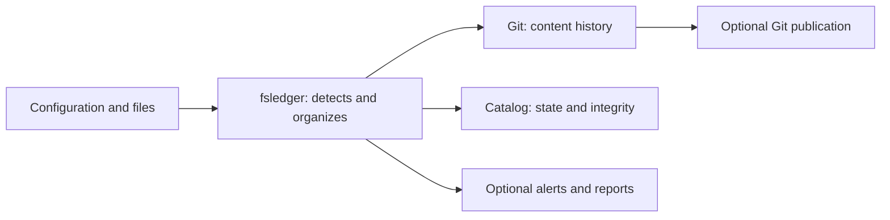

# fsledger

**Detect unexpected file changes, investigate incidents, and recover recorded versions on Linux.**

[English](README.md) | [Español](README.es.md)

fsledger combines file integrity monitoring (FIM), automatic Git history, and alerts.
It helps you answer which files changed, when the changes were observed, and how they
differ from the previous observation. When Linux provides the evidence, it also records the
observed user and process.

Preserve contents in Git for investigation and recovery, keep hashes and metadata
without copying contents, or combine both approaches. Use that evidence to investigate
suspected malware, unauthorized changes, and deployment mistakes.

## Contents

- [Why fsledger](#why-fsledger)
- [Use cases](#use-cases)
- [Features](#features)
- [Malware detection and incident response](#malware-detection-and-incident-response)
- [Comparison with similar tools](#comparison-with-similar-tools)
- [Architecture](#architecture)
- [Requirements](#requirements)
- [Installation](#installation)
- [Getting started](#getting-started)
- [Configuration](#configuration)
- [Everyday use](#everyday-use)
- [Data protection](#data-protection)
- [License](#license)

## Why fsledger

Most integrity checkers tell you that a file changed. fsledger also shows how it changed
and who changed it when Linux can tell, and gives you the previous version back.

- **The whole answer in one tool.** What changed and when, the contents before and after
  in Git, and the observed user and process.
- **Nothing else to run.** Two static binaries and a local catalog: no agent manager,
  indexer, database server, or dashboard. Publish history to the Git server you already use.
- **Leaves your system as it was.** No `.git` inside your directories, and Audit is used
  passively: fsledger never installs rules or takes control of auditd.
- **Built for production servers.** Real-time detection with fanotify and inotify,
  reconciliation for what events can miss, scheduled scans for large trees and remote
  filesystems, and queues that survive restarts.
- **Quiet alerts.** Grouped notifications, filters by user, command, or path, deferred
  commits for noisy files, and scheduled reports.
- **Recovery included.** Compare versions and restore one into a separate directory or
  in place.

## Use cases

- **Investigate suspected malware.** Identify unexpected scripts, altered application
  files, or changes to startup configuration in the paths you monitor.
- **Understand configuration changes.** Keep versions of `/etc` and your applications'
  configuration to compare their previous and current states.
- **Monitor websites and services.** Detect changes to contents, file types, symlink
  targets, permissions, and ownership, compared with the previous observation.
- **Review activity without following every event.** Receive grouped alerts or scheduled
  reports with the affected paths and observed changes.
- **Handle each service's needs separately.** Store the configuration you want to version
  in Git and use metadata inventories for trees whose contents you do not need to archive.
- **Share history beyond the server.** Publish repositories to your Git server and,
  if explicitly enabled, apply changes from a trusted branch.

## Features

- **Automatic Git history.** Each repository keeps an independent copy of its sources,
  with grouped commits and recognizable paths. It does not add `.git` to application
  directories.
- **Integrity monitoring.** Compare each observation with the previous one: content hash,
  file type, symlink target, permissions, and ownership. SHA256 is the default algorithm.
- **Context for investigations.** Use information available from fanotify, `/proc`,
  and Linux Audit to enrich changes with user and process details. If the actor cannot
  be identified, the change is still recorded with an unknown actor.
- **Detection adapted to your environment.** Combine fanotify, inotify, and reconciliation,
  or use interval or cron scans when you prefer scheduled traversal.
- **Noise control.** Filter alerts by user, command, or path, group notifications,
  and defer commits for frequent changes while retaining the latest observed pending version.
- **Alerts and reports.** Send alerts by email or Slack and scheduled summaries by email.
  Pending queues survive restarts.
- **Recovery from recorded versions.** Inspect Git diffs, preview a restore, and extract
  an earlier version to a separate directory before deciding what to put back into service.
- **Optional AI.** Add summaries to commits or reports, with path selection and redaction
  rules applied before information is sent to the provider.
- **CLI administration.** Validate configuration, check status, diagnose capabilities,
  run full scans, and restore recorded versions. Includes OpenRC and systemd integration.

## Malware detection and incident response

An unexpected write can be the first visible sign of a compromised website or service.
fsledger makes those writes easier to notice and investigate: alerts identify affected
paths, integrity checks compare them with the previous observation, and Git history lets you
inspect the recorded contents before and after a change.
Hash and attribute comparisons can reveal an unexpected change without knowing the
malware family or the vulnerability involved in advance.

| Observed change | How fsledger helps |
| --- | --- |
| A script appears in a monitored web directory | Records the addition and can send a change alert. |
| PHP or JavaScript code is modified | Records hash differences; Git profiles also preserve contents for review. |
| Cron jobs, service settings, or SSH keys change | Records content and permission changes and user/process evidence. |

These signals need investigation: a legitimate deployment can produce the same kinds
of changes. A Git commit or a delivered alert does not mean that a change is legitimate,
and Git history can contain malicious versions as well as legitimate ones.

### Example: PHP2Shell

[Aikido's PHP2Shell article][php2shell] discusses CVE-2026-109618 and CVE-2026-109619.
The [PHP advisory of 21 October 2026][php-security] confirms critical remote code
execution vulnerabilities and lists the fixes. Apply the relevant PHP or distribution
security updates; installing fsledger does not close those vulnerabilities.

As an illustrative scenario, suppose an attacker gains code execution and then writes
a web shell into a monitored `/srv/www` tree or modifies an existing PHP file.
If fsledger observes that write, it can record the change, notify your team, and retain
the contents in a Git profile. The recorded differences show what changed in the file,
even when the filename itself looks ordinary.
This illustrates filesystem monitoring, not a detector specific to those CVEs or a
claim about how they have been exploited.

### Make monitoring useful before an incident

1. **Establish trust first.** Review a clean deployment before you start monitoring it:
   the [first inventory](#integrity) is the state later changes are compared with.
   Starting monitoring on an already infected server records the infected state as normal.
   Review the changes that each deployment produces.
2. **Select paths for the evidence you need.** Include application code and relevant
   configuration, scheduled jobs, and access keys. Consider upload directories too:
   excluding an entire writable tree can hide unexpected scripts. Use a DB profile
   where retaining contents would expose secrets or consume too much space, and review
   [exclusions and reserved paths](#data-protection).
3. **Enable timely alerts and verify delivery.** Use `watch.backend: auto`, keep
   reconciliation and full hash scans enabled, and keep `integrity.hash.on_event: true`.
   Select a configured destination in `notifications.use` and include `change`,
   `error`, and `recovery` in `notifications.events`.
   Check `fsledger doctor` and `fsledger status`, then confirm
   that a controlled change produces an alert. The nightly `web-polling` example reports
   file changes on its report schedule; it is not configured for prompt change alerts.
4. **Keep evidence beyond the affected host.** Publish Git history to a private remote
   and protect backups and notifications independently. Local state and a writable Git
   remote are not tamper-proof: an attacker with sufficient privileges can alter evidence
   or stop monitoring. Publication copies Git history, not the complete integrity catalog.
5. **Investigate before restoring.** Preserve evidence and contain the affected service.
   Review the alerts and reports for the affected paths; with the daemon stopped, `verify`
   rescans every source and records in the catalog the changes not observed yet.
   For Git profiles, review the history and
   [restore a verified version to a separate directory](#everyday-use). Fix the entry
   point before returning the service to production. Restoring recorded files neither
   removes every extra malicious file nor proves the host is clean; DB profiles retain
   no file contents to restore.

fsledger provides evidence about observed filesystem changes. It does not block exploit
requests or process execution, classify files as malware, or remove infections. An attack
that only uses memory, reads secrets, or changes data outside the monitored paths may
leave no evidence in fsledger. Detection also depends on exclusions, watcher coverage,
scan timing, and notification delivery. Use it alongside patching, least privilege,
application protection, logs, and independent backups.

## Comparison with similar tools

Each tool covers part of the same need. This summary follows each project's public
documentation as of October 2026; check it for the version you use.

| Tool | Real time | Who changed it | Previous contents | Alerts | Needs a server | Platforms |
| --- | --- | --- | --- | --- | --- | --- |
| **fsledger** | Yes | When Linux reports it | Git, with restore | Email, Slack, reports | No | Linux |
| [FIM][achiefs-fim] | Yes | With auditd | No (event history) | Through an indexer | No | Linux, macOS, Windows |
| [Wazuh FIM][wazuh-fim] | Yes | Who-data (Audit) | Text diffs | Wazuh server | Yes | Linux, Windows, macOS, others |
| [AIDE][aide] | No | No | No | Check reports | No | Unix-like |
| [etckeeper][etckeeper] | No | No | `/etc` in Git | No | No | Unix-like |
| [gitwatch][gitwatch] | Yes | No | Git | No | No | Linux, macOS |

fsledger takes the user and process from fanotify, `/proc`, and the Audit rules you already
have, without installing any; a writer it cannot identify is recorded as unknown and the
change is still kept. Wazuh adds its own Audit rules for who-data, and FIM needs auditd.

**FIM** and **Wazuh FIM** suit mixed Linux, Windows, and macOS estates, or teams that already
collect security events in an indexer or SIEM. fsledger can run alongside them on Linux
servers to keep contents and recovery points.

**AIDE** suits periodic verification against a baseline that you initialize and update
explicitly, while fsledger compares each observation with the previous one and records
every change it observes.

**etckeeper** suits the history of `/etc` and its relationship with package updates, and
**gitwatch** suits automatic commits of a working directory as you save files.

**fsledger** suits Linux servers where you want, in one self-contained tool, to know what
changed, inspect and recover earlier contents, see who did it when possible, and receive
grouped alerts, without running a server or an indexer. Git and DB profiles can monitor the
same sources: contents where you want history, metadata only where contents are secret or
too large to archive.

## Architecture

fsledger organizes monitoring around your services: you choose what to watch,
what to preserve, and how to receive the results. You can start with a single directory
and add profiles with different policies as your needs grow.



**History kept separate from applications.** Git repositories store their own copies;
DB profiles preserve metadata without duplicating file contents. Both maintain an
integrity catalog. Monitoring leaves the sources unchanged unless you explicitly enable
bidirectional synchronization. The CLI also supports restoring files on request.

**Continuity for everyday operations.** Watchers detect events, and reconciliation checks
the state on disk. An unstable file retains its last valid copy while other files can
continue to be processed. Pending notifications are stored durably, and remote publication
failures do not stop local history from being recorded.

**Control per repository.** Each profile serializes its copy and Git operations,
while different repositories can work concurrently. A shared budget limits scanning work.
Report preparation and alert delivery run outside the copy and commit work.

The `fsledgerd` service handles monitoring, and the `fsledger` CLI provides administration.
Git preserves history, while a local Pebble catalog stores the inventory and pending work.
No additional database server is required.

## Requirements

- **Linux** to run the daemon and CLI.
- **Git 2.36 or later** for content repositories; older versions do not sync commits to disk.
- **Go 1.27.3 or later and Make** to build from source. Production binaries are built
  without CGO and do not require Go to be installed at runtime.
- Read permissions on the sources and write permissions on state directories.
  fanotify may require additional privileges; automatic mode provides alternatives
  using inotify and polling.
- Access to a Git remote, notification transport, or AI provider only if you enable
  those features. Schedules with a time zone require the corresponding IANA time zone data.

## Installation

### Prebuilt Linux x86_64 binaries

Published [GitHub releases](https://github.com/inode64/fsledger/releases) attach
`fsledger-linux-x86_64`, `fsledgerd-linux-x86_64`, `LICENSE`, and `SHA256SUMS` after
the project checks pass. Both binaries include the release tag in `--version`, are
built without CGO, and use `GOAMD64=v1` for compatibility with older x86-64 CPUs.

Download all four assets from the same release and verify them before use:

```sh
sha256sum --check SHA256SUMS
chmod +x fsledger-linux-x86_64 fsledgerd-linux-x86_64
./fsledger-linux-x86_64 --version
./fsledgerd-linux-x86_64 --version
```

The assets contain the executables; configuration examples, manual pages, and service
files are available in the source archive for the same tag. Review the configuration
as described in [Getting started](#getting-started) before running the daemon.

### Building from source

```sh
git clone https://github.com/inode64/fsledger.git
cd fsledger
make build
sudo make install
```

Installation adds both binaries, manual pages, and configuration examples.
It does not overwrite existing configuration files or start the service.
The default destinations are `/usr/bin/fsledger`, `/usr/sbin/fsledgerd`, and
`/etc/fsledger`. You can adjust them using `PREFIX`, `SYSCONFDIR`, and the other
installation variables in the [Makefile](Makefile); `DESTDIR` supports package staging.

Make uses `GOAMD64=v1` by default to maintain compatibility with older x86-64 CPUs.
You can identify a build with `make build VERSION=v1.2.3` and check the result
using `fsledger --version`.

**Before starting**, review the installed profiles. `system` selects configuration
for Git; `web-polling` selects `/srv/www` for a nightly inventory and enables email
with example settings. Configure that notifier or disable its alerts and reports.
To start with only `system`, set `paths.repositories: [services/system.yaml]`
in the main YAML file. See [Getting started](#getting-started) to validate the selection.

### OpenRC

```sh
sudo make install-openrc
sudoedit /etc/fsledger/fsledger.yaml
sudo rc-service fsledger checkconfig
sudo rc-update add fsledger default
sudo rc-service fsledger start
sudo rc-service fsledger status
```

You can select a different YAML file in `/etc/conf.d/fsledger` using `fsledger_config`.
To apply configuration changes, run `sudo rc-service fsledger restart`.

### systemd

```sh
sudo make install-systemd
sudoedit /etc/fsledger/fsledger.yaml
sudo fsledger check
sudo systemctl daemon-reload
sudo systemctl enable --now fsledger
sudo journalctl -u fsledger -f
```

To apply configuration changes, run `sudo systemctl restart fsledger`.
The [included unit](packaging/fsledger.service) restricts writable paths;
adjust its configuration if you customize storage or enable writes to the sources.

### Upgrading

Download or check out the new source version, rebuild, and install the binaries
with `sudo make install-bin install-man`. This target updates binaries and manual pages
without adding example profiles. Validate the YAML with the new CLI and restart the service
to use the new executable. Keep the previous version so you can revert an upgrade if needed.

## Getting started

Review the main configuration and profiles before the first startup:

```sh
sudoedit /etc/fsledger/fsledger.yaml
sudoedit /etc/fsledger/services/system.yaml
sudo fsledger check -c /etc/fsledger/fsledger.yaml
sudo fsledger doctor -c /etc/fsledger/fsledger.yaml
```

`check` validates the options and selected paths. `doctor` checks the environment's
capabilities and shows the available detectors. For an initial foreground run,
with the service stopped:

```sh
sudo fsledger run -c /etc/fsledger/fsledger.yaml
```

Stop that run before starting the OpenRC or systemd service. The daemon prepares
repositories automatically and performs an initial scan by default; on an empty catalog
it records every entry as created (see [Integrity](#integrity)). A polling profile
with `on_start: false` waits for its schedule.

With the service running, you can check its status and the history of `system`:

```sh
sudo fsledger status
sudo git -C /var/lib/fsledger/repos/system log --stat
sudo git -C /var/lib/fsledger/repos/system log -p -- etc/ssh/sshd_config
```

Mirror paths preserve the structure relative to `/`: for example,
`/etc/ssh/sshd_config` is stored as `etc/ssh/sshd_config` inside the repository.
You can inspect and extract versions with standard Git tools.

## Configuration

The main configuration defines shared policies and where to load profiles from.
Each repository can adjust its own options. Omitted fields inherit the global value,
and unknown fields are rejected to catch configuration errors.

### Paths and reusable profiles

A minimal main configuration file:

```yaml
paths:
  repositories: [services]
runtime: /run/fsledger
storage:
  path: /var/lib/fsledger/repos
```

A `services/system.yaml` profile for versioning configuration:

```yaml
type: git
paths:
  - /etc
  - /usr/src/linux/.config
  - /var/spool/fcron/*.orig
notifications:
  use: []
```

The file name determines the repository name. Profile directory paths are relative
to the main YAML file; sources use absolute paths or patterns over them.
Missing entries are skipped without error and included when they appear in a subsequent
reconciliation. An entry or pattern that cannot be read (permission denied, I/O error, stale
handle, symlink loop) is skipped too, but never taken as deleted: the daemon keeps what it
recorded there, and `verify` refuses to run until it can be read again.
Selection supports `*`, `?`, and `[...]` within each path component;
recursive `**` patterns are reserved for exclusions and other filters that support them.

You can use `${HOST}` or `$HOST` in YAML values and keys. They expand to the `HOST`
environment variable or, if it is unset, the system hostname.
See the [complete configuration example](examples/fsledger.yaml) to add reusable
exclusion profiles, notifiers, and templates.

### Continuous or scheduled monitoring

`watch.backend: auto` selects detectors based on the available capabilities and maintains
reconciliation. To scan a tree on a specific schedule, use a DB profile with polling:

```yaml
type: db
paths: [/srv/www]
watch:
  backend: polling
  reconcile:
    schedule: "15 3 * * *"
    timezone: UTC
    on_start: false
    on_stop: false
integrity:
  hash:
    full_scan_schedule: "15 3 * * *"
    full_scan_timezone: UTC
```

This example scans the tree and computes full hashes at 03:15 UTC. Cron expressions
have five fields; you can also choose intervals. A scheduled scan observes the state
that exists when it runs, so it does not capture changes that appear and disappear
between scans. The [complete nightly profile](examples/services/web-polling.yaml)
adds email alerts and reports.

### Integrity

Git and DB repositories maintain an inventory of hashes and attributes. Each observation
is compared with the previous one: a difference in content hash, file type, symlink target,
permissions, or ownership (`hash`, `type`, `target`, `mode`, `uid`, `gid`) is recorded as a
change. Other attributes (size, timestamps, inode) are kept in the inventory but never
produce a change on their own. In web trees,
`integrity.directories: false` leaves directory entries out of the inventory while
the files inside are still monitored.

Extended attributes and ACLs are always recorded and compared only when a repository
selects them with `integrity.xattrs: true` (this includes file capabilities set with
`setcap` and security labels) and `integrity.acl: true`. If a source's filesystem does
not support a selected comparison, `doctor` warns about it, and the daemon logs it at
start and keeps a warning in the repository status.

A modification time moved more than one hour before the file's birth time (`btime`), as
`touch -d` leaves it, is a change even when the content is the same. A copy that replaces
a file and keeps its time (`tar`, `rsync -a`, `unzip`) creates a new file with a new
`btime`, so it is only reported when something else differs. Restoring a time in place
keeps the `btime` and is reported: `cp -p` over an existing file, and `tar` or `rsync -a`
on directories that already exist (unless `integrity.directories` is false). Alerts and
reports flag any change of a file whose `mtime` predates its `btime`.

`integrity.hash.algorithm` selects the hash, SHA256 by default. With `on_event: true`
files are hashed as their events arrive, and `full_scan_interval` or `full_scan_schedule`
rehash every file periodically. Changing the algorithm reports every regular file as a
content change when it is next hashed. `xxhash64` is not cryptographic: a deliberate
collision can hide a content change.

The first inventory of a repository is the starting point for later comparisons, so review
the sources before you start monitoring them. The first scan of an empty catalog records
every entry as created and, when change alerts or reports are enabled, announces all of
them. To build it silently, stop the daemon, set `notifications.use: []` and
`reports.enabled: false` for that repository, run `verify`, and then restore its alerts
and reports.

With the daemon stopped, `verify` rescans every source, records the differences in the
catalog and queues their notifications, which the daemon sends when it runs again. It
does not commit to the Git mirror; the daemon's next reconciliation does. It exits with
status 0 when nothing changed, 2 when it recorded changes (also on a first inventory),
and 1 when it fails. A Go runtime crash also exits with 2, so scripts should also check
that it printed its JSON result:

```sh
sudo fsledger verify --repository system
```

### Alerts and reports

Immediate alerts support email and Slack, templates, and change grouping.
Every email, alert or report, ends with a signature naming the fsledger version and
the project URL; Slack messages carry none.
`notifications.ignore` filters change alerts by user, command, or path; it does not alter
the inventory or reports. `commit.defer` lets you defer commits
for specific paths or actors until another non-deferred change or a `flush`.
There is no maximum delay, and the latest observed pending version survives restarts.

Reports have their own schedule. This fragment can be added to the main YAML file
or a profile and requires a configured `email-ops` email notifier:

```yaml
reports:
  enabled: true
  format: summary
  schedule: "0 8 * * *"
  timezone: Europe/Madrid
  use: [email-ops]
  send_empty: false
```

`summary` brings together totals for the period and a sample of paths; `detailed` sends
the details split into bounded parts. Reports are disabled by default.
Their journal is independent of immediate alerts and preserves pending evidence
across restarts or delivery failures. Gaps in observation are flagged as incomplete
coverage. Counts represent observations, not commits or unique files.

You can configure the transport using the [email](examples/notifiers/email-ops.yaml)
and [Slack](examples/notifiers/slack-ops.yaml) examples, and customize alerts with the
[included templates](examples/templates). Report schedules are independent of scanning:
choose their timing based on how long your scans actually take.

### Git publication and synchronization

To publish a Git repository's history, add this to its profile:

```yaml
storage:
  git:
    remote: ssh://git@git.example/configuration.git
    branch: main
    push_interval: 1m
    push_timeout: 30s
```

Configure credentials in SSH or Git. fsledger publishes only the specified branch,
without force pushes, and retries network failures while continuing to record local changes.
Each repository needs its own branch: two repositories cannot publish to the same branch
of one remote URL or path.

If you also want to apply changes from that branch, enable
`storage.git.bidirectional: true`. Publish the local history first and work from
a clone of that same history. Only *fast-forward* updates are accepted; pending local
changes take priority, and conflicts require manual resolution.

This option allows sources to be modified with the daemon's permissions: use a trusted
branch and authorize its writable paths in systemd. Replacements are atomic per file,
not across the entire tree; an interruption can leave partial changes, and there is
no automatic rollback. The journal allows pending work to be recovered after a restart.
See [fsledger.yaml(5)](packaging/man/fsledger.yaml.5) for details.

### AI summaries

AI profiles are loaded from `ai/`, alongside the main YAML file. To add summaries
to a Git repository's commits, select an existing profile and the allowed paths:

```yaml
ia_commit: [resumen]
ia_include: [/etc/ssh/sshd_config]
```

OpenAI, Anthropic, and OpenAI-compatible endpoints are supported. Redaction rules
are applied to paths and contents before building the diff sent to the provider.
An AI failure allows the commit to proceed with its usual message.

Reports can enable `reports.ai` separately. In that case, only selected metadata is sent,
without file contents, attribute values, or process commands. Both features are disabled
by default. Profile configuration and selection are described in
[fsledger.yaml(5)](packaging/man/fsledger.yaml.5).

## Everyday use

With the default configuration at `/etc/fsledger/fsledger.yaml`:

```sh
fsledger check --effective
fsledger doctor
fsledger status
fsledger flush --repository system
```

`check --effective` shows the resolved configuration without credentials. `status` brings
together repositories, detectors, scans, pending changes, and Git publication. `flush`
asynchronously requests processing of deferred Git changes; check `status` afterward
to confirm the result. While a long reconciliation runs, `status` reports the repository as
busy rather than stopped. A repository that fails is retried automatically while the others
keep running. Options a command does not use, such as `--repository` with `status`, are
rejected. Add `-c PATH` to commands if you use a different main configuration file.

With the daemon stopped, you can preview a pending report without consuming it,
calling AI, or sending email:

```sh
fsledger report preview --repository system
```

Also with the daemon stopped, `outbox clear` discards every notification queued by a
repository without sending it, for example when its mail relay cannot accept them.
A notification that keeps failing stops retrying after about a day: `status` warns about
it, and it stays queued until a daemon restart retries it or `outbox clear` discards it.
Recorded changes stay in the catalog:

```sh
fsledger outbox clear --repository system
```

`restore` recovers the contents of a path from the Git mirror as they were on a given
date and writes them on the server. It works while the daemon runs because it only
reads Git objects. The source is a repository path (`/etc/ssh` and `etc/ssh` are
equivalent); the destination defaults to the original location. The date accepts
`YYYY-MM-DD` (meaning the end of that day), `YYYY-MM-DD HH:MM[:SS]` in local time, or
RFC 3339. With `--overwrite off` (the default) existing files are left alone; `always`
replaces them keeping their mode and owner; `newer` replaces them only when the chosen
commit is later than the file. Symlinks are never followed: a destination directory that
is or lies below one is refused, and entries below a symlink or a failed directory fail.
`--dry-run` prints the plan without writing. Ownership, ACLs and extended attributes are
not restored:

```sh
sudo fsledger restore --repository system --date "2026-10-01 09:00" /etc/ssh /tmp/rescue
sudo fsledger restore --repository system --date 2026-10-01 --overwrite always /etc/ssh/sshd_config
```

The service logs to stderr by default. To write a log file, set `logging.file` to an
absolute path; `logging.level` accepts `debug`, `info`, `warning`, and `error`.
Rotation is external and requires a restart to reopen the file.
Configuration changes also require a service restart.

The installed manuals, `man fsledger`, `man fsledgerd`, and `man 5 fsledger.yaml`, provide
more detail on commands and options. You can also read [fsledger(1)](packaging/man/fsledger.1)
and [fsledgerd(8)](packaging/man/fsledgerd.8) in the repository.

## Data protection

- **Choose what to archive before starting.** A secret that enters Git can remain
  in its history even if you exclude it later. AI redaction rules protect the provider's
  input; they do not change or encrypt archived bytes.
- **Separate contents and metadata.** Git stores contents, symlinks, and the executable
  bit; the catalog records attributes such as ownership, permissions, ACLs,
  or xattrs. Git does not preserve empty directories or all those metadata fields in its tree.
  Names Git refuses even on Linux, such as `git~1`, `.git.` or a symlink named `.gitmodules`,
  stay in the catalog but are not copied to the mirror.
- **Keep sources outside managed state.** Do not edit mirrors while the daemon is running.
  Storage and runtime directories must be private and are automatically excluded from
  that instance's sources. Independent instances need shared exclusions. `.git` components
  and names starting with `.fsledger-inbound-` or `.fsledger-restore-`, the temporaries that
  fsledger itself creates in sources, are always excluded too; incoming changes cannot add them.
- **Configure exclusions for your applications.** They support recursive globs such as `**`,
  and global and repository rules are combined. An excluded directory also excludes its contents:
  a trailing slash, as in gitignore, is dropped and repeated slashes collapse, while patterns
  with `.` or `..` components are rejected because they never match. Start with the
  [example profile](examples/excludes/common.yaml) and adjust it for caches, temporary files, and secrets.
- **Protect access to the remote.** Branch restrictions control who can write,
  not who can read other branches. Use separate private repositories when you need
  to separate access to the data.

Symlinks are preserved as links and are not followed during copying.
Attribution identifies what the system could observe: it does not guarantee identifying
every process or preserving every intermediate version of concurrent writes.
The priority is to preserve the observed state without inventing an identity.

Process command lines are used only in memory for local `command_regex` filters.
Commits, catalog evidence, and notifications record the available user, PID, and executable,
without process arguments. Git failures report exit status or cancellation without
including command arguments or hook output in status, logs, or alerts.

## License

fsledger is free software licensed under **GPL-3.0-or-later**. You can redistribute
and modify it under version 3 of the GNU General Public License or any later version.
It is distributed without warranty. See [LICENSE](LICENSE).

[gitwatch]: https://github.com/gitwatch/gitwatch
[etckeeper]: https://etckeeper.branchable.com/
[aide]: https://aide.github.io/
[achiefs-fim]: https://github.com/Achiefs/fim
[wazuh-fim]: https://documentation.wazuh.com/current/user-manual/capabilities/file-integrity/index.html
[php2shell]: https://www.aikido.dev/blog/critical-vulnerabilities-in-php-php2shell
[php-security]: https://www.php.net/archive/2026.php
